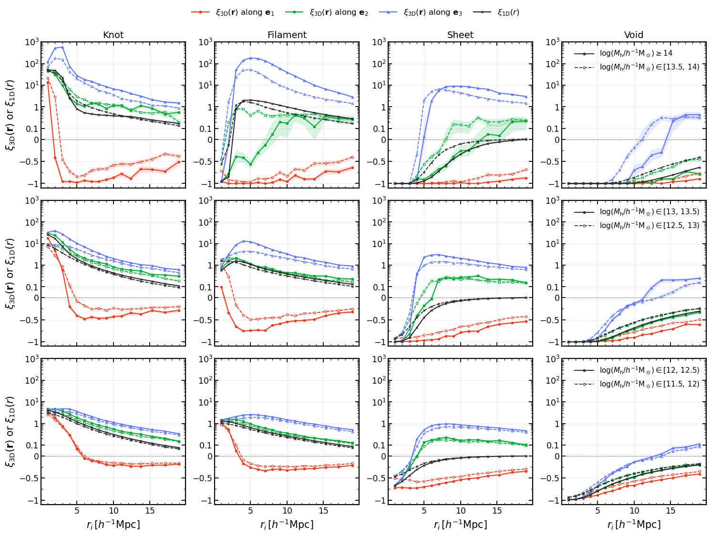

### Halo-Cosmic Web Relation

Dark matter halos are the bridge between observed galaxies and in matter field which are mainly invisible dark matter.

$$
  {\rm Matter\; Field}\quad \Leftrightarrow \quad {\rm Dark\; Matter \; Halo}\quad  \Leftrightarrow \quad {\rm Galaxy}
$$

Our research focus on the relation between the dark matter halo and the matter field, especially the tidal-field and the cosmic webs classified by it (T-web method). Till now, we've done several tests on:

- How local density and cosmic web affect the halo mass function and assembly bias.

- Anisotropy of the halo-web cross-correlation function under tidal field eigen-frame.

**Highlights**:
- **Paper**: Halo formation and distribution around cosmic web

  **Hongfei Yu**, Huiyuan Wang et al. |\| [arXiv: 2610.34042](https://arxiv.org/abs/2610.34042)

- **PyPackage**: [`pywccf`](https://github.com/Phiyu/pywccf)

<!--  -->

---

### Non-Gaussianity

Precise estimation of primordial non-Gaussianity (PNG) is essential for distinguishing different inflation models and learning about primordial universe. A widely studied PNG model is called local-type $f_{\rm NL}$ which is defined as

$$
  \Phi = \Phi_{\rm G} + f_{\rm NL}(\Phi_{\rm G}^2 - \langle \Phi_{\rm G}^2 \rangle).
$$

The current best $f_{\rm NL}$ constraint comes from the Planck experiment's analysis of CMB, reaching $f_{\rm NL} = 0.9\pm 5.1$. Our research focus on improve the constraint from cosmic shear either by higher-order statistics nor neural network but with enough physical transparency.

**Highlights**:
